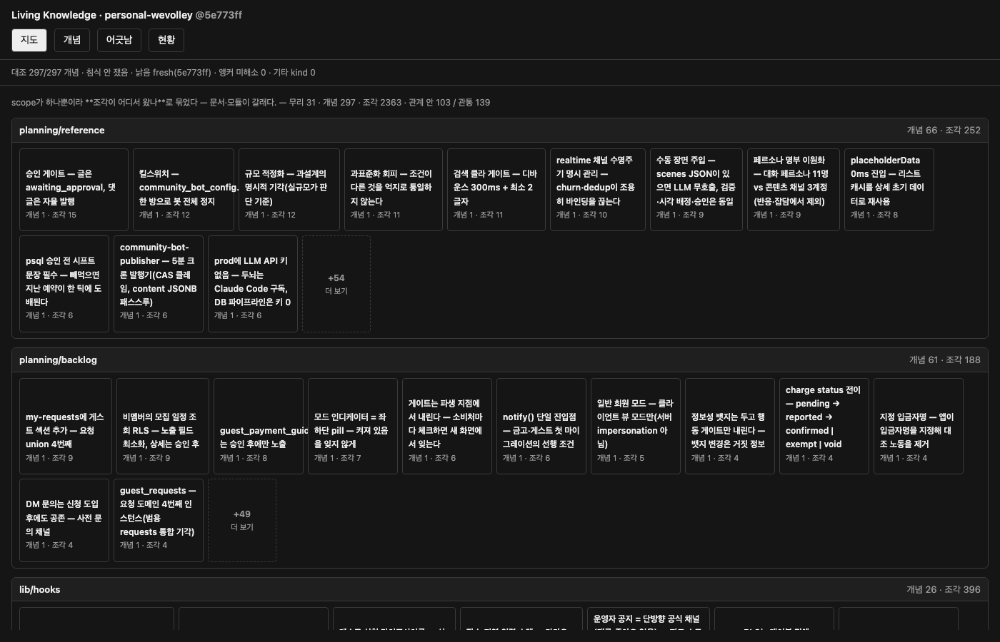
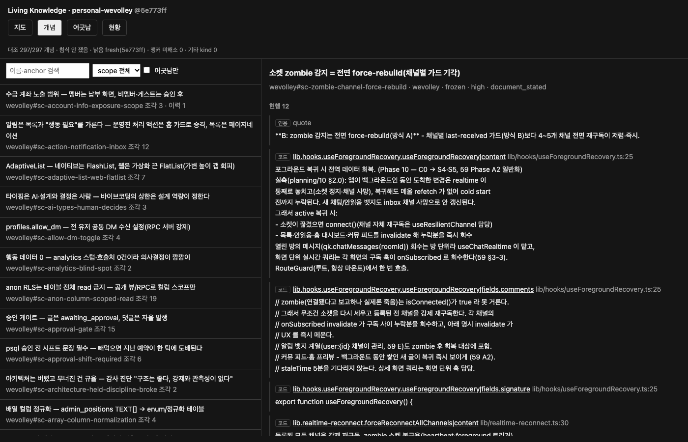

<p align="center">
  
</p>

<h1 align="center">Living Knowledge Lab — Engine</h1>

<p align="center">
  기획 문서와 코드에 흩어진 결정을 연결하고,<br>
  변경 이력과 영향 범위를 추적하는 지식 구조화 엔진
</p>

<p align="center">
  <a href="https://github.com/hadan-HwH/living-knowledge-lab-engine/actions/workflows/verify.yml">
    
  </a>
  
  <a href="https://github.com/hadan-HwH/product-planning-ir"></a>
</p>

<p align="center"><sub>개인 연구 프로젝트 · 2026.07–08 · 개발 일시 중단</sub></p>

---

## 프로젝트 소개

> 이전 연구 [PPIR](https://github.com/hadan-HwH/product-planning-ir)에서 드러난 한계를 바탕으로 다시 설계한 후속 연구입니다.

기획 문서와 실제 구현 코드는 같은 기능을 서로 다른 방식으로 설명합니다. 변경이 쌓이면 어느 설명이 최신인지, 특정 결정이 코드의 어디에 반영되어 있는지, 이전에는 왜 다르게 설계했는지 파악하기 어려워집니다.

<b>Living Knowledge Lab(LKL)</b>은 Markdown 문서와 Python·TypeScript 코드를 분석해 관련 정보를 **개념 단위로 연결하는 연구용 엔진**입니다. 이렇게 구성된 지식 구조를 <i>정본(canonical)</i>으로 관리하며, 원문 출처와 변경 이력을 함께 보존합니다.

목표는 문서를 새로 작성하게 만드는 것이 아니라, **이미 작성한 문서와 코드에서 필요한 맥락을 찾아갈 수 있게 하는 것**입니다.

## 주요 기능

| 기능 | 설명 |
| --- | --- |
| **개념 중심 구조화** | 여러 문서와 코드에 흩어진 정보를 같은 개념 아래 연결합니다. |
| **출처 추적** | 정본에 포함된 내용을 원본 문서의 위치나 코드 심볼과 연결합니다. |
| **변경 이력 관리** | 현재 유효한 내용과 과거 기록을 구분해 결정의 변화를 확인합니다. |
| **영향 범위 탐색** | 특정 코드나 개념의 변경과 연결된 항목을 조회합니다. |
| **일관성 점검** | 관련 자료 사이의 값 불일치 후보를 제시해 검토를 돕습니다. |

### 동작 화면

공개 데모에는 개인 사이드 프로젝트 <b>위볼리(Wevolley)</b>의 기획 문서와 TypeScript 코드가 사용되었습니다.

**Knowledge Map** — 문서와 코드에서 추출한 개념의 분포를 확인하는 화면



<details>
<summary><b>Concept Detail — 개념별 원문과 변경 이력 보기</b></summary>

<br>



</details>

### 데모 데이터 규모

| 원문 섹션 | 정본 개념 | 개념 간 관계 | 기록된 재생 회차 |
| :---: | :---: | :---: | :---: |
| **1,482** | **297** | **242** | **12** |

<sub>2026년 8월 기준, 저장소에 포함된 단일 데모 코퍼스의 기록입니다. 이 수치는 외부 데이터에 대한 일반화 성능이나 탐지 정확도를 의미하지 않습니다.</sub>

## 기술적 접근

이 프로젝트에서는 LLM의 의미 판단과 검증 가능한 데이터 처리 과정을 분리했습니다.

<picture>
  <source media="(prefers-color-scheme: dark)" srcset="assets/flow-dark.svg">
  
</picture>

- **LLM의 역할 제한:** 의미 기반 개념 추출과 관계 판단에 LLM을 활용하고, 기록된 결과를 조립·검증하는 단계는 결정론적으로 처리합니다.
- **원문 기반 검증:** 정본에 포함되는 본문은 원문에 실제로 존재하는 구간인지 대조합니다. 이는 근거 없는 문장 삽입을 제한하지만, 의미 해석의 정확성까지 보장하지는 않습니다.
- **재현 가능한 결과:** 저장된 추출 기록을 기준으로 정본을 다시 생성하고, 동일한 입력에서 바이트 단위로 같은 결과가 나오는지 확인합니다. 재현성의 보장 범위는 **LLM 추출 이후**입니다.
- **지식 구조 검증:** 출처, 참조 무결성, 이력 보존, 재현성 등에 관한 16개 불변식을 검증 대상으로 정의했습니다. 일부 경계조건은 추가 보완이 필요한 상태입니다.

내부 처리 과정과 검증 규칙은 [엔진 기술 문서](engine/README.md) 및 [불변식 문서](engine/INVARIANTS.md)에서 확인할 수 있습니다.

## 실행 및 확인

Python 3.9 이상 환경이 필요합니다. 공개 데모의 **테스트·재생·질의에는 LLM API가 필요하지 않습니다.** 새 자료의 의미 추출은 별도 LLM 실행 과정에 의존합니다.

```bash
git clone https://github.com/hadan-HwH/living-knowledge-lab-engine.git
cd living-knowledge-lab-engine
pip install -r requirements.txt

# 테스트 실행
cd engine
python -m pytest -q
cd ..

# 저장된 기록을 이용해 정본 재생
scripts/regen.sh personal-wevolley
```

다음 명령으로 개념의 현재 상태, 변경 이력, 영향 범위를 조회할 수 있습니다.

```bash
cd engine

# 프로젝트 요약
python structure_app.py brief personal-wevolley wevolley

# 최근 변경된 개념
python structure_app.py recent personal-wevolley wevolley

# 특정 코드 심볼과 연결된 개념
python structure_app.py impact personal-wevolley lib.realtime-reconnect.forceReconnectAllChannels
```

재생 후 `engine/fixtures/personal-wevolley/canon/canon-viewer.html` 파일을 브라우저에서 열면 정본 뷰어를 확인할 수 있습니다.

## 프로젝트의 출발점

기획 문서는 Slack · Notion · 회의록 · Word · Figma 등 여러 도구에 흩어져 있었습니다. 이 문서들을 하나로 통합하기 위해 개인 PM 핸드북을 정리하는 작업에서 시작해, 팀 단위 기획 문서를 GitHub 기반 Markdown 저장소 한곳으로 모으고 정책 · 규칙 · 설명을 구분해 관리했습니다. 문서를 한곳에서 검토하고 변경 사항을 반영하기는 편해졌지만, 서로 연결된 결정과 구현을 찾는 과정은 여전히 수작업에 의존했습니다.

이 문제를 해결하기 위한 첫 번째 실험이 [PPIR](https://github.com/hadan-HwH/product-planning-ir)이었습니다. PPIR에서는 지식을 구조화하는 가능성을 확인했지만, 사람이 개념 구조를 직접 작성하고 유지해야 하는 부담이 컸습니다.

LKL에서는 접근을 바꿨습니다. **사람이 구조화된 문서를 추가로 관리하기보다, 기존 문서와 코드에서 구조를 추출하는 방식**을 연구했습니다.

<picture>
  <source media="(prefers-color-scheme: dark)" srcset="assets/timeline-dark.svg">
  
</picture>

## 현재 상태와 한계

현재 개발 중단된 상태입니다.

| 항목 | 현재 상태 |
| --- | --- |
| **추출 재현성** | 저장된 원장 이후의 처리 결과는 재생·검증할 수 있지만, LLM 추출 결과 자체는 실행마다 달라질 수 있습니다. |
| **검증 범위** | 공개 코퍼스 1종과 소규모 기준 데이터(gold) 2건을 사용했습니다. 다른 프로젝트에 대한 일반화는 검증하지 못했습니다. |
| **불일치 탐지** | 표에 포함된 값의 차이를 중심으로 확인하며, 산문 사이의 의미적 모순은 탐지하지 못합니다. |
| **검증 체계** | 일부 단조성 기준값과 최신성 경고 처리 등 보완이 필요한 경계조건이 남아 있습니다. |
| **실사용 효과** | 실제 업무에서 변경 영향 분석에 드는 시간이나 의사결정 품질이 개선되는지는 측정하지 못했습니다. |

후속 연구를 진행한다면 검증 체계의 신뢰성을 먼저 높이고, 다른 데이터셋에서의 재현성과 실제 업무 활용 가치를 확인하는 것이 우선 과제입니다.

## 기술 및 문서

**Python 3.9+ · YAML · Markdown · TypeScript 파싱 · LLM 보조 추출 · pytest · GitHub Actions · 단일 HTML 뷰어**

| 문서 | 내용 |
| --- | --- |
| [Engine Documentation](engine/README.md) | 파이프라인, 재생, 질의, 검증 흐름 |
| [Invariants](engine/INVARIANTS.md) | 16개 불변식과 설계 배경 |
| [Demo Corpus](engine/fixtures/README.md) | 예시 데이터와 저장 구조 |

<sub>공개 저장소에는 위볼리 데모 코퍼스만 포함되어 있습니다. 별도로 사용한 비공개 데이터는 포함하지 않았으며, 이에 의존하는 테스트는 사유를 기록하고 건너뜁니다.</sub>
