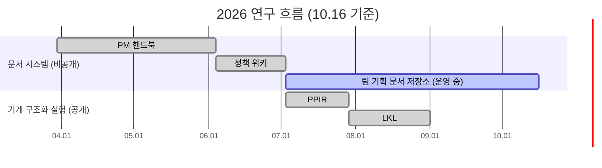
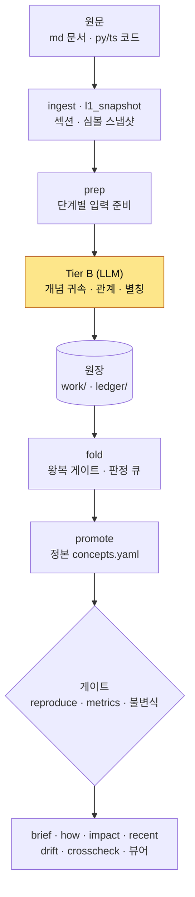

<p align="center">
  
</p>

<h1 align="center">Living Knowledge Lab — Engine</h1>

<p align="center">
  기획 문서와 코드를 <b>정본(canonical) 개념 그래프</b>로 구조화하고, 문서가 바뀌어도 이력과 함께 증분으로 유지하는 엔진
</p>

<p align="center">
  <a href="https://github.com/hadan-HwH/living-knowledge-lab-engine/actions/workflows/verify.yml"></a>
</p>

<p align="center">
  <b>상태: 연구 프로토타입 · 2026.08 중단</b> · <a href="https://github.com/hadan-HwH/product-planning-ir">PPIR</a>(이전 프로젝트)을 진단한 뒤 다시 설계한 후속작
</p>

---

## 배경

개인 PM 핸드북에서 시작해 팀 기획 문서를 Notion에서 GitHub Markdown으로 옮기고, **정책 → 규칙 → 설명** 3층으로 정리했습니다.
읽기는 쉬워졌지만, 어긋난 규칙이나 옛 결정은 여전히 사람이 찾아야 했습니다.
그래서 이 문서를 **기계가 계산할 수 있는 구조**로 바꾸는 방법을 연구했습니다: [PPIR](https://github.com/hadan-HwH/product-planning-ir) → [LKL](https://github.com/hadan-HwH/living-knowledge-lab-engine).
LKL은 그 **두 번째 시도**입니다.

## 목차

1. [프로젝트 정보](#1-프로젝트-정보)
2. [시작 가이드](#2-시작-가이드)
3. [기술 스택](#3-기술-스택)
4. [화면 구성 (정본 뷰어 · 질의)](#4-화면-구성-정본-뷰어--질의)
5. [주요 기능](#5-주요-기능)
6. [아키텍처](#6-아키텍처)
7. [기타](#7-기타)

---

## 1. 프로젝트 정보

| 항목 | 내용 |
|---|---|
| 개발 기간 | PM 핸드북 (비공개) `2026.03.30` → 팀 기획 문서 저장소 (비공개) `07.03 ~ 운영 중` → [PPIR](https://github.com/hadan-HwH/product-planning-ir) `07.03 ~ 07.28` → **LKL** `07.29 ~ 08.31` |
| 상태 | 연구 프로토타입 · 2026.08 중단 |
| 형태 | 개인 프로젝트 |
| 담당 | 파이프라인 설계 · 결정론 코어 · 불변식 게이트 · 질의 · 뷰어 |
| 이전 작업 | [PPIR](https://github.com/hadan-HwH/product-planning-ir) → 진단 → LKL |
| 배포 | 없음 |

### 프로젝트 소개

기획 지식은 문서·화면 명세·코드에 흩어져 있고, 같은 개념이 곳곳에서 조금씩 다르게 적힙니다. 문서가 개정되면 옛 설명은 사라지고, 왜 바뀌었는지도 같이 사라집니다.

LKL은 마크다운 문서와 Python · TypeScript 코드를 읽어서, **같은 개념에 대한 조각을 한 개념 아래 모은 정본**을 만듭니다.
LLM은 "이 조각이 어떤 개념에 속하나"를 고르는 **추출 한 단계에만** 씁니다. 그 뒤의 조립 · 병합 · 재생 · 검증은 전부 결정론입니다.
정본에 들어가는 모든 문장은 **원문 부분 문자열이어야** 하므로 지어낸 문장이 끼어들 수 없습니다. 문서가 바뀌면 옛 서술은 지워지지 않고 **이력 평면**으로 내려갑니다.

### 연구 흐름: 문서 → 구조 → 기계 추출



| 단계 | 기간 | 설명 |
|---|---|---|
| ① PM 핸드북 (비공개) | 03.30 ~ 06.03 | 개인 작업 문서. Notion에서 GitHub Markdown으로 이전을 시작한 단계 |
| ② 정책 위키 → 팀 기획 문서 저장소 (비공개) | 06.04 ~ 운영 중 | 팀 단위 기획 문서 저장소. 정책 → 규칙 → 설명 3층으로 관리하며, 개발 · 기술 조직이 GitHub 이슈로 요청하고 기획이 PR로 반영 |
| ③ [PPIR](https://github.com/hadan-HwH/product-planning-ir) | 07.03 ~ 07.28 | 기획 문서를 타입 있는 atom 그래프로 전환하는 실험. 사람이 구조를 직접 작성하는 부담이 커서 중단 |
| ④ **LKL** (이 저장소) | 07.29 ~ 08.31 | 원문 문서와 코드에서 기계가 정본 개념 그래프를 추출하는 엔진 |

### PPIR에서 무엇을 바꿨나

PPIR을 쓰지 않게 된 이유를 가설로 세워 진단했습니다. 가장 그럴듯한 설명은 아래 세 가지의 결합이었고, LKL은 각각에 답하도록 설계했습니다.

| PPIR의 문제 (진단) | LKL의 답 |
|---|---|
| **표현 밀도 과잉**: 가벼운 조사부터 확정 결정까지 전부 타입 있는 atom으로 직접 써야 함 | 사람이 구조를 쓰지 않습니다. **원문 조각을 그대로 모아** 개념을 조립합니다 |
| **intake 자동화 미완성**: 문서 → 구조 이동이 수작업 | 원문 → 정본을 **파이프라인**으로 자동화. LLM은 귀속 판단 한 단계만, 나머지는 결정론 |
| **소비 workflow 부재**: 그래프로만 할 수 있는 반복 사용이 없음 | **질의 3종**(how · impact · recent)과 브리핑 · 뷰어를 소비 경로로 둡니다 |

---

## 2. 시작 가이드

### 요구 사항

| 항목 | 버전 |
|---|---|
| Python | 3.9 이상 (3.9 ~ 3.14에서 테스트 통과 확인) |
| 패키지 | `pyyaml`, `pytest` (`requirements.txt`) |
| LLM | 재생 · 질의 · 테스트에는 필요 없음 (새 문서를 추출할 때만) |

### 설치 및 실행

```bash
git clone https://github.com/hadan-HwH/living-knowledge-lab-engine.git
cd living-knowledge-lab-engine
pip install -r requirements.txt

# 테스트 (데모 코퍼스 장착 상태)
cd engine && python -m pytest -q && cd ..      # 1051 passed, 11 skipped

# 정본 전량 재생: 원장 → 정본 + 지표 + 게이트 (LLM 호출 0)
scripts/regen.sh personal-wevolley
git status                                       # 변경 없음 = 커밋된 정본과 바이트 단위로 같음
```

질의:

```bash
cd engine
python structure_app.py brief  personal-wevolley wevolley                                   # 브리핑
python structure_app.py how    personal-wevolley wevolley#sc-zombie-channel-force-rebuild   # 이 개념은 어떻게 되어 있나
python structure_app.py impact personal-wevolley lib.realtime-reconnect.forceReconnectAllChannels  # 이걸 바꾸면 어디가 영향받나
python structure_app.py recent personal-wevolley wevolley                                   # 최근 무엇이 바뀌었나
```

정본 뷰어는 `engine/fixtures/personal-wevolley/canon/canon-viewer.html`을 브라우저로 열면 됩니다(재생 시 같이 다시 만들어집니다).

---

## 3. 기술 스택

**Language · Data**


-3178C6?style=flat-square&logo=typescript&logoColor=white)

**LLM 추출 (Tier B 한 단계)**


**Test & CI**


**Viewer**

-E34F26?style=flat-square&logo=html5&logoColor=white)

---

## 4. 화면 구성 (정본 뷰어 · 질의)

데모 코퍼스는 개인 사이드 프로젝트 **위볼리**(배구 클럽 · 커뮤니티 앱, Expo + Supabase)의 기획 문서와 TypeScript 코드입니다.

### 정본 뷰어 — 지도

문서 · 모듈 위치별로 개념이 어디에 모였는지 한 화면에 보여줍니다. 상단 배너는 무엇을 쟀고 무엇을 안 쟀는지(커버리지)를 0과 구분해서 표시합니다.


### 정본 뷰어 — 개념

한 개념 아래 **기획 문서의 인용과 코드 조각**(`lib/hooks/useForegroundRecovery.ts:25` 등)이 나란히 모입니다. 모든 조각은 원문 위치로 연결됩니다.


| 탭 | 보여주는 것 |
|---|---|
| 지도 | 위치(문서 · 모듈)별 개념 · 조각 분포 |
| 개념 | 개념 목록 검색, 개념별 현행 조각 · 이력 · 출처 |
| 어긋남 | 개념 간 · 층 간 불일치 후보 (판정은 사람이) |
| 현황 | `canon/metrics.yaml` 원본 수치 (뷰어가 다시 세지 않음) |

### 질의 출력 예시 (데모 코퍼스 실제 출력, 발췌)

`impact`: 이 코드 심볼을 바꾸면 어떤 개념이 영향받나

```
# 영향 — lib.realtime-reconnect.forceReconnectAllChannels

## 직접 (1) — 이 조항을 본문으로 들고 있다
- wevolley#sc-zombie-channel-force-rebuild  소켓 zombie 감지 = 전면 force-rebuild(채널별 가드 기각)

## 1홉 (2) — 관계로 이어져 있다
- wevolley#sc-foreground-recovery  포그라운드 복귀 회수 — 앱 레벨 단일 핸들러 + 화면 focus 이중 안전망  (triggers)
- wevolley#sc-resilient-channel    useResilientChannel — 지수 백오프 재구독 + onSubscribed invalidate  (derived_from)
```

`recent`: 결정이 바뀐 개념

```
## 결정이 바뀐 개념 (10)
- 게스트 신청 라이프사이클 — 신청→승인→납부 안내→확인→참석 — 0005 (이력: 0004)
- 거절 사유 선택 필수 — 게스트 알림에 사유 포함 — 0005 (이력: 0004)
- 승인 후 소통은 기존 DM 재사용 — 추가 개발 없음 — 0005 (이력: 0004)
```

`how`: 개념 하나를 출처와 함께 펼칩니다. 별칭(`forceReconnectAllChannels`), 출처 조항 6개(문서 섹션 + 코드 심볼), 본문 2개가 나오고, 본문에는 Before/After 지표표(채팅방 진입 480ms → 132ms 등)가 원문 그대로 들어 있습니다.

**데모 코퍼스 규모** (`canon/metrics.yaml`)

| 항목 | 값 |
|---|---|
| 원문 섹션 (문서 + 코드) | 1,482 |
| 정본 개념 | 297 (조각이 여러 개 모인 개념 비율 87.2%) |
| 개념 간 관계 | 242 |
| 본문 | 662,489자 |
| 현행 결정이 있는 개념 | 18 |
| 이력으로 내려간 조각 / 원본이 사라져 보존된 조각 | 32 / 182 |
| 재생 회차 원장 | 12 |
| 인용 게이트 | 237건 통과 · 0건 거부 |

---

## 5. 주요 기능

### 5-1. 왕복 게이트: 지어냄 0

LLM이 고른 조각은 정본에 들어가기 전에 **원문의 부분 문자열인지** 기계적으로 대조합니다. 원문에 없는 문장은 거부되고 판정 큐로 갑니다.

### 5-2. 결정론 코어와 재현성

LLM 호출은 추출(Tier B) 한 단계뿐입니다. 그 결과는 원장(ledger)에 기록되고, 이후 단계는 원장만 보고 결정론으로 돕니다.
`regen.sh`는 원장에서 정본을 처음부터 다시 만든 뒤 한 번 더 접어 대조합니다(`reproduce`). **같은 원장이면 결과가 바이트 단위로 같아야** 통과합니다. CI가 매 push마다 이것을 확인합니다.

### 5-3. 현행 / 이력 평면

문서가 개정되면 옛 서술은 지워지지 않고 이력 평면으로 내려갑니다. 브리핑은 기본으로 현행('어떻게')만 보여주고 `--why`를 주면 이력을 펼칩니다. 이력이 현행을 덮어 읽을 양이 늘어나지 않게 두 평면을 분리합니다.

### 5-4. 불변식 16종

게이트가 코드("기계가 할 수 있나")가 아니라 **정본 자체**("정본이 그렇게 됐나")를 잽니다.

| # | 불변식 | 막는 것 |
|---|---|---|
| 1 | 단조성(존재) | 개념 · 본문 · 별칭 · 이력이 promote로 사라짐 |
| 2 | 보존 | 추출된 하위 개념이 조용히 증발 |
| 3 | 왕복 인용 | 원문에 없는 문장 생성 |
| 4 | 재현성 | 같은 입력이 다른 산출 |
| 5 | 최신성 | 정본이 어느 시점 원문에서 왔는지 모름 (보고) |
| 6 | 평면 분리 | '왜'가 '어떻게'를 덮음 |
| 7 | 시금석 | 원본이 사라지면 안 읽히는 정본 |
| 8 | anchor 유일성 | 같은 anchor 둘 = 개념 정체성 붕괴 |
| 9 | 정본 단조 | 회차를 거치며 정본이 줄어듦 |
| 10 | 본문 키 참조 무결 | 조각이 없는 개념을 가리켜 화석이 됨 |
| 11 | 스냅샷 순서 | 정본보다 오래된 스냅샷으로 재생 |
| 12 | 아카이브 종결 | 반증 문서를 안 읽은 주장이 확정 자리에 앉음 (보고) |
| 13 | 출처 | 식별자 · 수치를 코드 대조 없이 사용 |
| 14 | 개념 간 대조 | 다른 개념에 앉은 두 주장이 서로를 못 만남 (보고) |
| 15 | 코드 본문층 | 함수 안의 근거가 구조적으로 안 보임 |
| 16 | 문서 신원 | 한 문서가 정본 안에서 두 신원으로 갈림 |

각 불변식이 왜 생겼는지(어떤 사고에서 나왔는지)는 [engine/INVARIANTS.md](engine/INVARIANTS.md)에 있습니다.

### 5-5. 조용한 미실행 금지

조건이 안 맞아 게이트가 돌지 않으면 키를 비워 두지 않고 **`skipped(사유)`를 남깁니다.** "안 쟀음"이 "0건"으로 읽히는 일을 막습니다. 테스트도 같은 규약이라, 데이터가 없는 테스트는 사유와 함께 skip됩니다.

### 5-6. 드리프트 · 층간 대조

- `drift`: 직전 회차 정본과 비교해 낡은 개념과 바뀐 조각을 보고합니다(현행 평면만 비교).
- `crosscheck`: 같은 개념 아래 문서와 화면 · 코드가 다른 값을 말하는지 후보를 냅니다. 값은 **숫자 집합**으로 비교해서 표 컬럼 구조 차이로 생기는 오탐을 줄입니다. 어느 쪽이 맞는지는 사람이 판정합니다.

---

## 6. 아키텍처

### 파이프라인



노란색 한 칸만 LLM이고 나머지는 전부 결정론입니다. 재생(`regen.sh`)은 원장부터 시작하므로 LLM 없이 돕니다.

| 단계 | 주체 | 산출 |
|---|---|---|
| ingest · l1_snapshot | 결정론 | `work/<app>/sections.yaml`, `canon/tier-a/<sha>.yaml` |
| prep | 결정론 | 추출 단계별 입력(필요한 입력만) |
| 개념 추출 · 귀속 · 관계 · 별칭 | **LLM (Tier B)** | `subconcepts` · `members` · `relations` · `aliases` |
| fold | 결정론 | `adjudication.yaml` (왕복 게이트 · 판정 큐) |
| promote | 결정론 | `canon/concepts.yaml` (정본) |
| metrics · drift · crosscheck | 결정론 | `canon/metrics.yaml` · `drift.yaml` · `crosscheck.yaml` |
| brief · how · impact · recent · view | 결정론 | 질의 출력 · `canon-viewer.html` |

### 재생 순서 (`scripts/regen.sh` → `engine/regen.py`)

```
archive_round → fold → promote → drift(+침식 감시) → promote 재확인 → reproduce → crosscheck → metrics → view
```

### 디렉토리 구조

```
living-knowledge-lab-engine/
├── engine/
│   ├── structure_app.py             # CLI 진입점 (ingest · prep · fold · promote · brief · how · impact · recent · drift · crosscheck · view …)
│   ├── regen.py                     # 재생 절차 본체
│   ├── ingest.py · l1_snapshot.py   # 원문 → 섹션 · 심볼 스냅샷
│   ├── parsers.py                   # md · py · ts 파서
│   ├── tier_b.py · extract.py       # LLM 추출 단계 입출력 계약
│   ├── canon_store.py · canon_select.py · consolidate.py   # 정본 조립 · 병합
│   ├── queries.py · brief.py · ask.py                      # 질의 · 브리핑
│   ├── crosscheck.py · shared_ground.py · provenance_gate.py · doc_identity.py   # 대조 · 게이트
│   ├── viewer.py · viewer_html.py · viewer_map.py           # 정본 뷰어
│   ├── registry.yaml                # 코퍼스 경계 레지스트리 (엔진 코드는 특정 이름을 모름)
│   ├── INVARIANTS.md                # 불변식 16종과 각각의 배경
│   ├── test_*.py                    # pytest 1051개
│   ├── research/                    # 비용 사다리 · 개념 발산 연구 모듈
│   └── fixtures/personal-wevolley/  # 데모 코퍼스
│       ├── work/wevolley/           #   섹션 · LLM 추출 원장 (배치별)
│       ├── ledger/                  #   결정 이벤트 · 회차 원장 12개
│       ├── canon/                   #   정본 · 지표 · 드리프트 · 대조 · 뷰어 HTML
│       └── bench/                   #   gold 벤치 2건
├── scripts/regen.sh                 # 정본 전량 재생 (결정론 · LLM 0)
└── requirements.txt
```

---

## 7. 기타

### 개발 문서

| 문서 | 내용 |
|---|---|
| [engine/README.md](engine/README.md) | 파이프라인 · 재생과 게이트 · 층간 대조 · 회차와 낡음 감시 상세 |
| [engine/INVARIANTS.md](engine/INVARIANTS.md) | 불변식 16종 · 각각이 생긴 사고 · 설계 규칙 |
| [engine/fixtures/README.md](engine/fixtures/README.md) | 코퍼스 데이터 구조 |

### 데이터에 대해

- 공개본에는 위볼리 코퍼스만 들어 있습니다. LKL을 함께 검증한 **비공개 코퍼스**와 LKL 자신의 설계 문서 코퍼스(lab-self)는 포함하지 않았고, 이 데이터에 의존하는 테스트는 사유와 함께 skip됩니다.
- 위볼리 코퍼스의 고객지원 이메일과 광고 ID는 예시 값으로 바꿨습니다.

### 멈춘 지점과 한계

| 한계 | 근거 |
|---|---|
| **추출이 에이전트 세션에 묶여 있음** | Tier B의 의미 판단(개념 귀속 · 관계 · 별칭)은 LLM 서브에이전트가 실행 지시서를 따라 수행합니다. 그래서 재현성은 **원장부터**만 보장되고, 추출 자체는 다시 돌리면 결과가 달라질 수 있습니다 |
| **검증 범위가 좁음** | 공개 코퍼스 1개와 gold 2건입니다. 남의 문서 뭉치로 일반화를 확인하는 다음 단계는 착수 전에 멈췄습니다 |
| **대조는 표만 함** | `crosscheck`는 표 안의 값 불일치만 잡습니다. 산문 속 불일치(부등호 역전, 오인용 등)는 사람이 찾아야 합니다 |
| **게이트 자체의 결함** | 불변식 9의 기준값이 가변 파일(`metrics.yaml`)이라 재실행하면 위반이 사라집니다. 최신성 경고가 종료 코드에 반영되지 않고, 문서에서 절을 지우는 삭제 경로는 아직 실측하지 못했습니다 |
| **침식 감시 미배선** | 위볼리 결정 문서의 번호 체계와 코드 쪽 결정 참조 체계가 달라서, 지금 배선하면 오탐만 나옵니다. 참조 체계를 먼저 정해야 합니다 |
| **소비 검증 없음** | PPIR을 멈춘 원인이던 "실제로 쓰이나"를, 업무 시간 절감 같은 지표로는 아직 재지 못했습니다 |

### 다음 단계

**GPU 없이 먼저 할 것.** 게이트가 믿을 만해야 그 위에 무엇을 얹어도 의미가 있습니다.

| 할 일 | 완료 판정 |
|---|---|
| 불변식 9의 기준값을 불변 원장(`ledger/rounds/`)으로 옮김 | `metrics`를 두 번 돌려도 위반이 남는다 |
| 최신성 경고를 종료 코드에 반영 | 낡은 스냅샷이면 `regen`이 실패로 끝난다 |
| 삭제 경로 실측 | 절을 지운 문서로 재생해서 시금석(불변식 7)이 조각을 보존한다 |
| 남의 코퍼스 1개로 일반화 | 다른 사람의 문서 뭉치가 같은 게이트를 통과해 뷰어에 뜬다 |
| 실제 업무 하나에 질의를 붙여 측정 | 예: 기획 변경 영향 확인에 `impact`를 쓴 전후 소요 시간 |

**GPU로 고도화할 것.** 위 한계 중 GPU가 직접 푸는 것에만 한정했습니다.

| 다음 단계 | 푸는 한계 | 완료 판정 |
|---|---|---|
| **추출을 로컬 오픈 웨이트 모델로** | 비공개 문서가 외부 API로 나가지 않습니다. 사내 문서에 적용하려면 사실상 전제 조건입니다. 비용 게이트(`research/cost_ladder.py`)도 API 단가 대신 GPU 시간 단가로 확장합니다 | 같은 원장 형식으로 추출하고, 인용 게이트 거부율이 API 모델과 비슷하다 |
| **결정론 경계를 추출 단계까지 올리기** | 지금은 원장부터만 재현됩니다. 가중치 고정 · greedy 디코딩 · 배치 불변 추론으로 "같은 원문이면 같은 원장"을 노립니다. GPU 연산의 비결정성 때문에 검증이 필요한 가설입니다 | 같은 원문을 두 번 추출해서 원장 diff가 0이다 |
| **판정 원장으로 소형 모델 증류** | 자동 승인 201건 · 판정 큐 86건 · 인용 게이트 결과가 이미 라벨 데이터입니다. LoRA 파인튜닝으로 사람의 판정 부담을 줄입니다. 코퍼스 1개로는 데이터가 부족해서 일반화 단계와 같이 가야 합니다 | 남겨 둔 평가 데이터에서 판정 큐 비율이 줄고 거부율은 유지된다 |
| **산문 불일치 후보 검출 (NLI 모델)** | 대조가 표만 하는 한계를 풉니다. 같은 개념 아래 문장 쌍의 모순 후보를 내고, 판정은 지금처럼 사람이 합니다 | 사람이 찾았던 산문 불일치 유형을 후보로 재현한다 |
