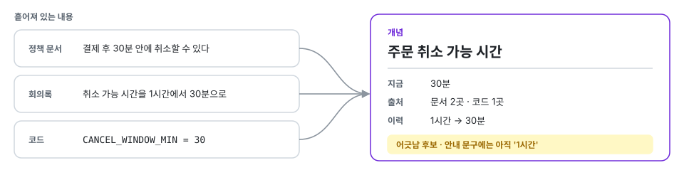
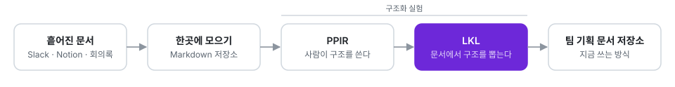
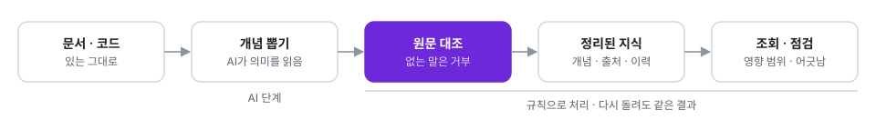
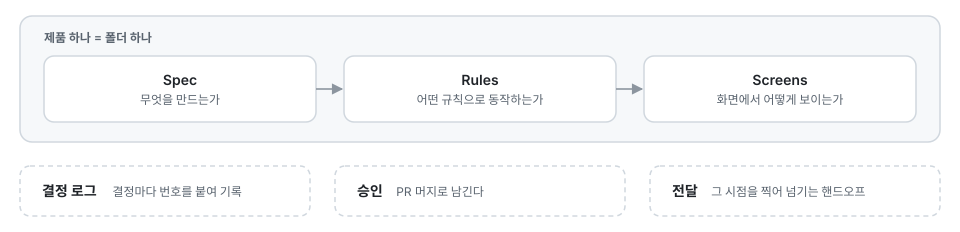

<p align="center">
  
</p>

<h1 align="center">Living Knowledge Lab — Engine</h1>

<p align="center">
  기획 문서를 정리하기 위한 실험 ②<br>
  이미 써 둔 문서와 코드에서 <b>같은 개념을 찾아 한곳에 연결</b>
</p>

<p align="center">
  <a href="https://github.com/hadan-HwH/living-knowledge-lab-engine/actions/workflows/verify.yml">
    
  </a>
  
  <a href="https://github.com/hadan-HwH/product-planning-ir"></a>
</p>

<p align="center"><sub>개인 연구 프로젝트</sub></p>

---

<picture>
  <source media="(prefers-color-scheme: dark)" srcset="assets/hero-dark.svg">
  
</picture>

## 배경

기획 문서와 실제 코드는 같은 기능을 서로 다른 말로 설명합니다. 변경이 쌓이면 이런 질문에 답하기 어려워집니다.

- 어느 설명이 최신인가?
- 이 결정은 코드 어디에 반영되어 있나?
- 예전에는 왜 다르게 정했나?

앞선 실험 [PPIR](https://github.com/hadan-HwH/product-planning-ir)에서는 사람이 구조를 직접 써 넣어야 했고, 그 부담 때문에 오래 유지하기 어려웠습니다. LKL 은 방향을 바꿨습니다. 문서를 새로 쓰게 하지 않고, <b>이미 있는 기획 문서와 코드에서 구조를 뽑아</b> 같은 개념끼리 연결합니다.

<picture>
  <source media="(prefers-color-scheme: dark)" srcset="assets/journey-dark.svg">
  
</picture>

## 주요 기능

| 기능 | 설명 |
| --- | --- |
| **개념으로 묶기** | 여러 문서와 코드에 흩어진 내용을 같은 개념 아래로 모읍니다. |
| **출처 연결** | 정리된 내용마다 원래 문서의 위치와 코드 위치를 붙입니다. |
| **변경 이력** | 지금 유효한 내용과 지난 내용을 구분해 보여 줍니다. |
| **영향 범위** | 코드나 개념 하나를 바꾸면 무엇이 함께 걸리는지 찾습니다. |
| **어긋남 점검** | 문서끼리 값이 다른 곳을 후보로 알려 줍니다. |

## 예시

'주문 취소 가능 시간'이 정책 문서, 회의록, 코드에 따로 적혀 있다고 해 보겠습니다. LKL 은 이 셋을 같은 개념으로 묶어 카드 한 장으로 정리합니다.

| 카드에 담기는 것 | 예시 |
| --- | --- |
| **지금 내용** | 결제 후 30분 안에 취소할 수 있다 |
| **출처** | 정책 문서의 해당 절, 회의록의 해당 줄, 코드의 해당 상수. 눌러서 원문으로 갑니다. |
| **이력** | 1시간 → 30분으로 바뀐 기록과 그때의 근거 |
| **어긋남 후보** | 안내 문구에는 아직 '1시간'으로 남아 있음 |

정리해 둔 뒤에는 세 가지를 물어볼 수 있습니다.

| 질문 | 명령 |
| --- | --- |
| 지금 기준이 뭐지? | `brief` — 프로젝트의 현재 상태 요약 |
| 최근에 뭐가 바뀌었지? | `recent` — 최근 바뀐 개념 |
| 이 코드를 고치면 어디가 걸리지? | `impact` — 코드 심볼과 연결된 개념 |

### 데모 데이터 규모

| 원문 섹션 | 정리된 개념 | 개념 간 관계 | 다시 만들어 본 횟수 |
| :---: | :---: | :---: | :---: |
| **1,482** | **297** | **242** | **12** |

<sub>개인 사이드 프로젝트의 기획 문서와 코드로 돌린 데모 기준입니다.</sub>

## 기술적 접근

<picture>
  <source media="(prefers-color-scheme: dark)" srcset="assets/flow-dark.svg">
  
</picture>

- **AI 는 의미를 읽는 데만**: 개념을 뽑고 관계를 판단하는 일만 AI 가 맡고, 조립과 검증은 규칙으로 처리합니다.
- **원문에 없는 말은 넣지 않는다**: 정리된 내용이 원문에 실제로 있는 구간인지 하나씩 대조합니다. AI 가 그럴듯한 문장을 지어 넣는 일을 막습니다.
- **다시 돌려도 같은 결과**: AI 가 뽑은 결과를 기록으로 남겨 두고, 그 기록으로 다시 만들면 바이트 단위까지 같은지 매번 확인합니다.
- **지켜야 할 규칙을 먼저 정한다**: 출처가 있는가, 참조가 끊기지 않았는가, 이력이 지워지지 않았는가 같은 규칙 16개를 정해 두고 검증합니다.

### 처리 단계

| 단계 | 처리 방식 | 결과 |
| --- | :---: | --- |
| **수집** | 규칙 | 문서 섹션과 코드 심볼 스냅샷 |
| **개념 뽑기** | AI | 개념 · 소속 · 관계 · 별칭 후보 |
| **원문 대조** | 규칙 | 원문에 없는 인용 거부, 판정 대기 목록 |
| **정리** | 규칙 | 개념별 지금 내용과 이력 |
| **검증 · 조회** | 규칙 | 지표 · 재현성 검증 · 어긋남 후보 · 뷰어 |

### 저장소 구조

```
living-knowledge-lab-engine/
├── engine/
│   ├── structure_app.py         # 명령 진입점 (수집 · 정리 · 조회)
│   ├── regen.py                 # 다시 만들기 절차
│   ├── ingest.py · parsers.py   # 문서 · 코드 수집과 파싱
│   ├── canon_store.py           # 조립 · 병합
│   ├── queries.py · brief.py    # 조회와 요약
│   ├── crosscheck.py            # 어긋남 후보 찾기
│   ├── provenance_gate.py       # 출처 검증
│   ├── viewer.py                # 뷰어 생성
│   ├── INVARIANTS.md            # 규칙 16개
│   └── fixtures/                # 데모 데이터
└── scripts/regen.sh             # 다시 만들기 실행
```

## 검증

GitHub Actions 에서 push 마다 아래 검증을 실행합니다.

| 단계 | 확인 내용 |
| --- | --- |
| **테스트** | 각 단계와 검증 관문의 동작 |
| **다시 만들기** | 저장한 기록만으로 AI 없이 처음부터 다시 생성 |
| **재현성** | 다시 만든 결과가 저장소의 결과와 바이트 단위로 같은지 |
| **규칙 16개** | 출처 · 참조 무결성 · 이력 보존 등 |

## 배운 점

- **사람이 쓰지 않아도 구조가 나옵니다.** 문서를 새로 쓰게 하지 않고도, 있는 자료만으로 개념 297개와 관계 242개를 뽑아 연결했습니다.
- **AI 를 믿는 범위를 정해야 합니다.** 의미 판단은 AI 에게 맡기되, 그 뒤는 기록과 규칙으로 고정해야 같은 결과를 다시 얻을 수 있었습니다.
- **값이 다른 곳은 잘 찾고, 뜻이 다른 곳은 어렵습니다.** 표에 적힌 값의 차이는 후보로 잡아내지만, 글과 글 사이의 뜻 차이는 다음 과제로 남았습니다.

## 팀 기획 문서 운영 방식

<picture>
  <source media="(prefers-color-scheme: dark)" srcset="assets/team-dark.svg">
  
</picture>

실험을 거쳐, 팀의 기획 문서는 사람이 쓰고 읽기 쉬운 단순한 구조로 정리했습니다.

- **제품 하나에 폴더 하나, 문서는 세 가지**: 무엇을 만드는지(Spec), 어떤 규칙으로 동작하는지(Rules), 화면에서 어떻게 보이는지(Screens)를 나눠 씁니다. 같은 사실은 한 문서에만 쓰고 나머지는 인용합니다.
- **결정은 번호를 붙여 남긴다**: 회의록 대신 결정 로그에 배경과 결정을 함께 적고, 문서에 반영됐는지까지 따라갑니다.
- **승인은 PR 머지**: 누가 언제 승인했는지가 저장소에 그대로 남습니다.
- **다른 팀에는 핸드오프로**: 계속 바뀌는 문서를 보여 주지 않고, 그 시점을 찍어서 넘깁니다.

## 실행 방법

<details>
<summary><b>명령 보기</b></summary>

<br>

Python 3.9 이상 환경이 필요합니다. 공개 데모의 테스트 · 다시 만들기 · 조회에는 LLM API 가 필요하지 않습니다.

```bash
git clone https://github.com/hadan-HwH/living-knowledge-lab-engine.git
cd living-knowledge-lab-engine
pip install -r requirements.txt

# 테스트 실행
cd engine
python -m pytest -q
cd ..
```

데모 데이터로 다시 만들고 조회하는 명령은 [엔진 기술 문서](engine/README.md)에 있습니다.

</details>

## 기술 및 문서

**Python 3.9+ · YAML · Markdown · TypeScript 파싱 · LLM 보조 추출 · pytest · GitHub Actions**

| 문서 | 내용 |
| --- | --- |
| [Engine Documentation](engine/README.md) | 파이프라인, 다시 만들기, 조회, 검증 흐름 |
| [Invariants](engine/INVARIANTS.md) | 규칙 16개와 설계 배경 |

<sub>공개 저장소에는 데모 데이터만 들어 있습니다.</sub>
